# Azure JumpBox, Docker & Ansible — Private Web Server Lab

**Project:** Azure infrastructure provisioning, SSH administration, Docker-based Ansible controller, and Web-1 automation  
**Azure region:** Central India · **Resource group:** `Cybrbee` · **Operating system:** Ubuntu Server 22.04 LTS

> **Evidence note:** Azure portal screenshots below document the actual infrastructure. Shell commands and Ansible results are based on recorded lab notes. `ansible/pentest.yml` is a reconstruction, **not** the original tested playbook. The DVWA deployment is not independently verified for this environment. Public IPs and allowed client IPs may change.

## 1. Project objective

I configured an Azure JumpBox to manage a private Ubuntu server through SSH and Ansible. The JumpBox hosted Docker, and an Ubuntu Docker container served as the Ansible control node. The intended workload was a Docker-based web-security training environment on Web-1.

### Logical architecture

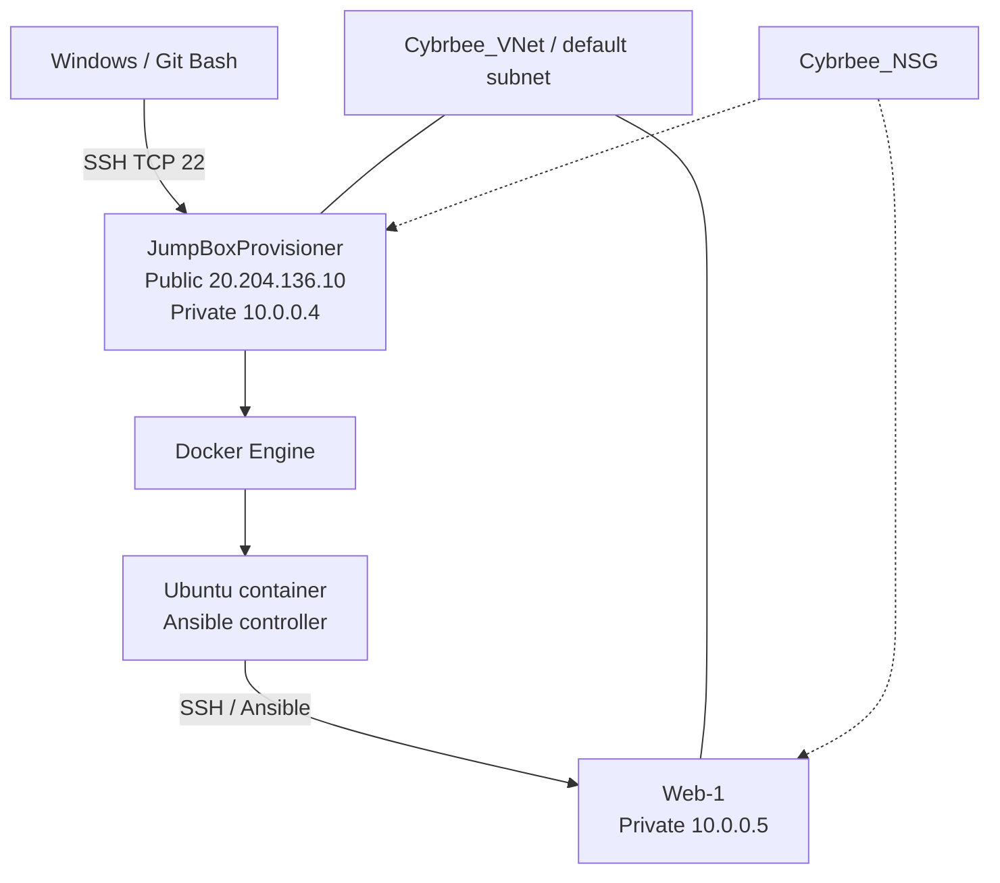

## 2. Provision the resource group

I used resource group **Cybrbee** in **Central India**. Azure showed **15 resources** and **8 successful deployments** at the time of capture. Some resources support a separate App Service website, and are not part of this Ansible lab.

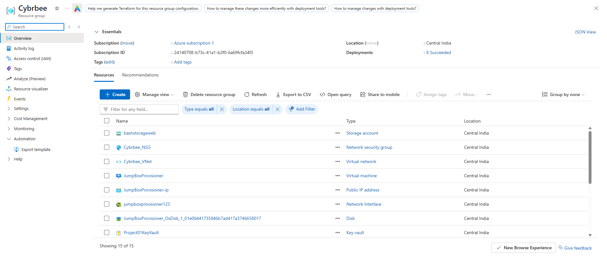
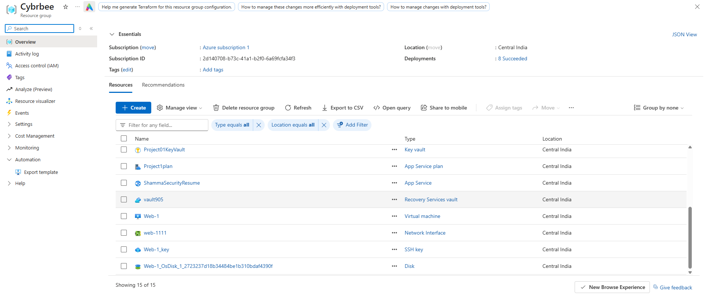

The lab-related resources include `JumpBoxProvisioner`, `Web-1`, `Cybrbee_VNet`, `Cybrbee_NSG`, NICs `jumpboxprovisioner123` and `web-1111`, `JumpBoxProvisioner-ip`, both OS disks, and the Azure `Web-1_key` resource.

## 3. Deploy JumpBoxProvisioner

I provisioned the JumpBox as an Ubuntu 22.04 LTS VM, size **Standard B2als v2**, with **2 vCPUs and 4 GiB RAM**. The VM uses a primary network interface `jumpboxprovisioner123`, private IP `10.0.0.4`, and public IP **`20.204.136.10`**. It was **stopped (deallocated)** when the screenshot was captured.

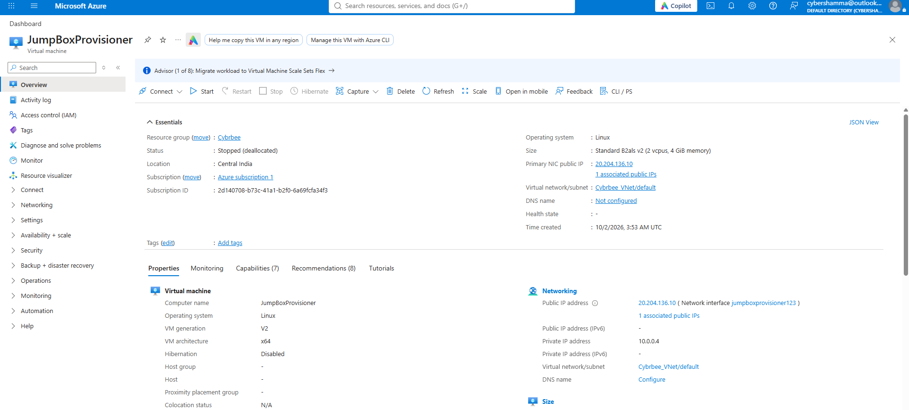
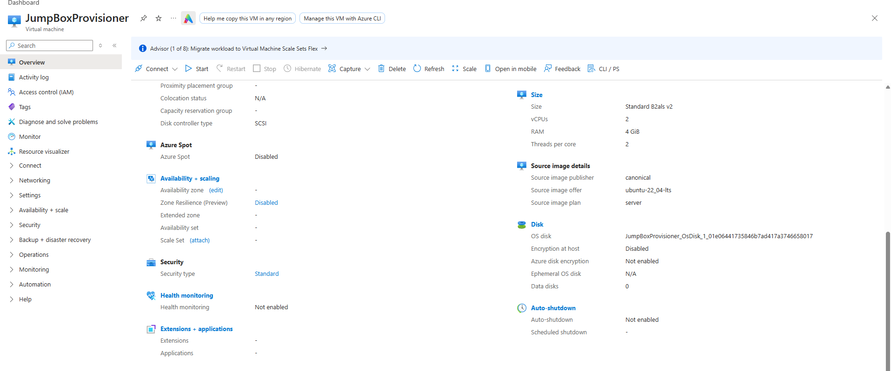

## 4. Deploy Web-1

I provisioned **Web-1** as Ubuntu 22.04 LTS, size **Standard B2as v2**, with **2 vCPUs and 8 GiB RAM**. Its NIC is `web-1111`, with private IP **`10.0.0.5`** and **no public IP**. It was also **stopped (deallocated)** at capture time.

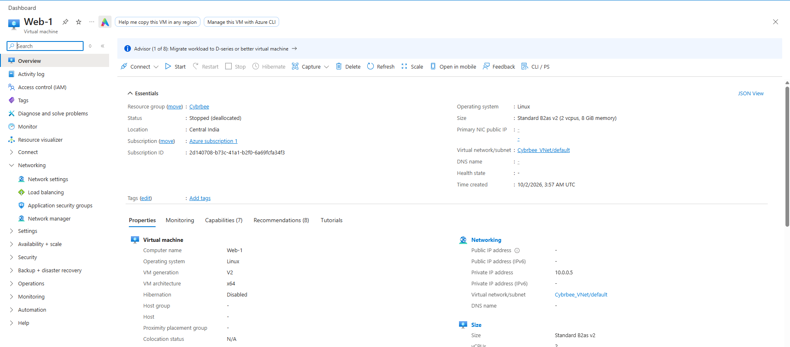
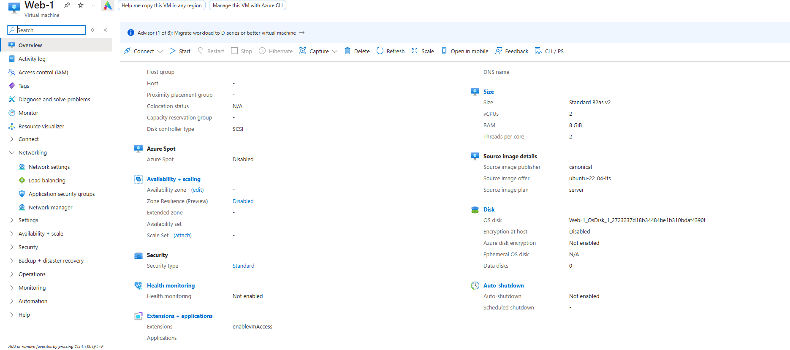

## 5. Configure private networking and NSG

Both VMs use `Cybrbee_VNet/default`, and both NICs are associated with **`Cybrbee_NSG`**. The shared NSG has the following custom inbound rules:

| Priority | Rule | Source | Destination | Port | Action |
|---:|---|---|---|---|---|
| 3998 | Intra_VNet_Comm | 10.0.0.5 | 10.0.0.4 | 3142 | Allow |
| 3999 | SSH-VNet | 10.0.0.4 | VirtualNetwork | TCP 22 | Allow |
| 4000 | SSH-Inbound | 71.169.13.18 | 10.0.0.4 | TCP 22 | Allow |
| 4096 | Deny-ALL | Any | Any | Any | Deny |

Azure default rules appear at priorities 65000, 65001 and 65500. Default outbound rules allow virtual-network and internet traffic, subject to other network controls. The port 3142 rule is present; **it does not by itself prove a package proxy was installed**. The `SSH-VNet` rule permits the intended JumpBox-to-Web-1 SSH path through this NSG, assuming other access requirements are satisfied.

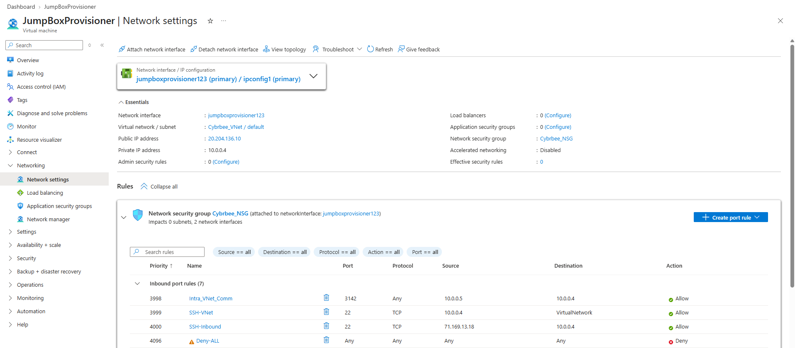
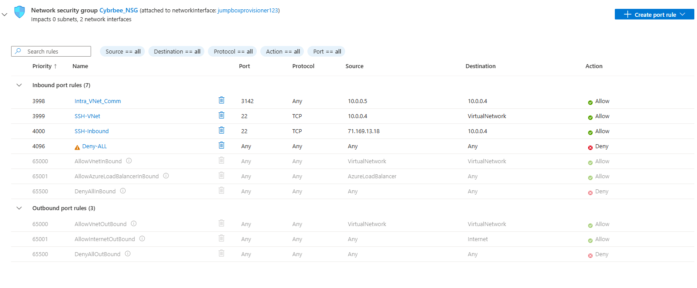
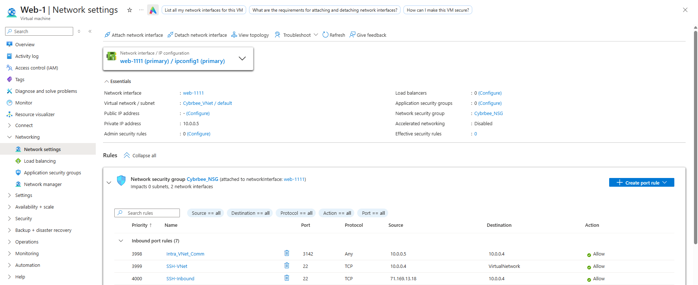
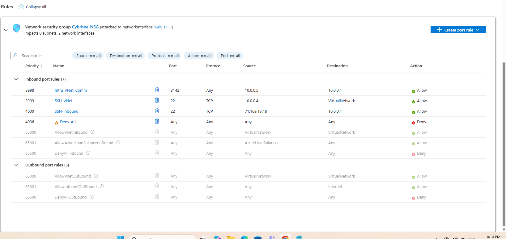

## 6. Connect from Windows Git Bash

I generated an RSA key pair locally with Git Bash. The public key could be registered for the Azure login; the **private key remains only on the administrator's computer**.

```bash
ssh-keygen -t rsa
cat /c/Users/cyber/.ssh/id_rsa.pub
ssh azureuser@20.204.136.10
```

If Azure was configured with a different PEM key, the connection would instead use `ssh -i /path/to/private-key.pem azureuser@20.204.136.10`. The exact private key used for the recorded successful connection was not verified from screenshots.

## 7. Install Docker on JumpBox

After logging into JumpBox, the recorded setup used:

```bash
sudo apt update
sudo apt install docker.io -y
sudo systemctl status docker
sudo docker pull ubuntu:latest
sudo docker images
sudo docker run -ti ubuntu:latest bash
```

A previously created container was visible as `sad_torvalds` and was restarted/attached with:

```bash
sudo docker container list -a
sudo docker start sad_torvalds
sudo docker attach sad_torvalds
```

**Note:** `docker run` creates a new container; `docker attach` connects to an existing running container. The default Docker container name is not guaranteed to be the same in a recreated environment.

## 8. Configure the Ubuntu container as Ansible controller

Inside the Ubuntu Docker container, I installed SSH tools and Ansible, generated a **separate** SSH key, and used its **public** key for Web-1 authentication.

```bash
apt update
apt install -y openssh-client nano ansible
ssh-keygen -t rsa
cat /root/.ssh/id_rsa.pub
ssh azureuser@10.0.0.5
```

The notes indicate that the container's public key was applied to Web-1 through Azure's SSH public-key reset process. They also record a successful SSH exit from Web-1. **Never publish** `/root/.ssh/id_rsa` or a Windows private key.

### Ansible configuration

```bash
mkdir -p /etc/ansible
cd /etc/ansible
nano hosts
nano ansible.cfg
```

`ansible/hosts`:

```ini
[webservers]
10.0.0.5 ansible_python_interpreter=/usr/bin/python3
```

`ansible/ansible.cfg`:

```ini
[defaults]
inventory = ./hosts
remote_user = azureuser
host_key_checking = True
```

The original recorded inventory used `10.0.0.5` and the recorded default user was `azureuser`. The repository config is an equivalent clean version. Verify the SSH host key fingerprint before accepting a first connection.

## 9. Verify Ansible connectivity

```bash
ansible all -m ping
```

**Recorded result:**

```text
10.0.0.5 | SUCCESS => {
    "changed": false,
    "ping": "pong"
}
```

This proves the Ansible controller reached Web-1 and ran the ping module **at the time of the original lab**. It does not prove the later Docker playbook completed.

## 10. Run and troubleshoot the playbook

The recorded playbook started by removing Apache, then attempted to install `docker.io`. The execution failed with:

```text
TASK [Install docker.io]
fatal: [10.0.0.5]: FAILED! => {
    "changed": false,
    "msg": "No package matching 'docker.io' is available"
}
```

To inspect package availability on Web-1:

```bash
ssh azureuser@10.0.0.5
cat /etc/os-release
sudo apt update
apt-cache policy docker.io
```

Possible causes include stale package indexes or missing repository components; the original cause and final resolution were **not confirmed**. The included [`ansible/pentest.yml`](ansible/pentest.yml) reconstructs the confirmed Apache removal and Docker installation objective. It is intentionally limited to the supported tasks rather than claiming an unverified DVWA deployment.

```bash
cd /etc/ansible
ansible-playbook --syntax-check pentest.yml
ansible-playbook pentest.yml
```

The original notes show execution of `ansible-playbook pentest.yml`, but not a confirmed end-to-end successful run. If DVWA is deployed later, add the validated container configuration and real deployment evidence.

## 11. Azure resource topology

The Azure Resource Visualizer screenshot below shows VM, NIC, disk, virtual-network and NSG dependencies. It also shows separate App Service and other shared resource-group assets, which are **not represented as part of the Ansible workflow**.

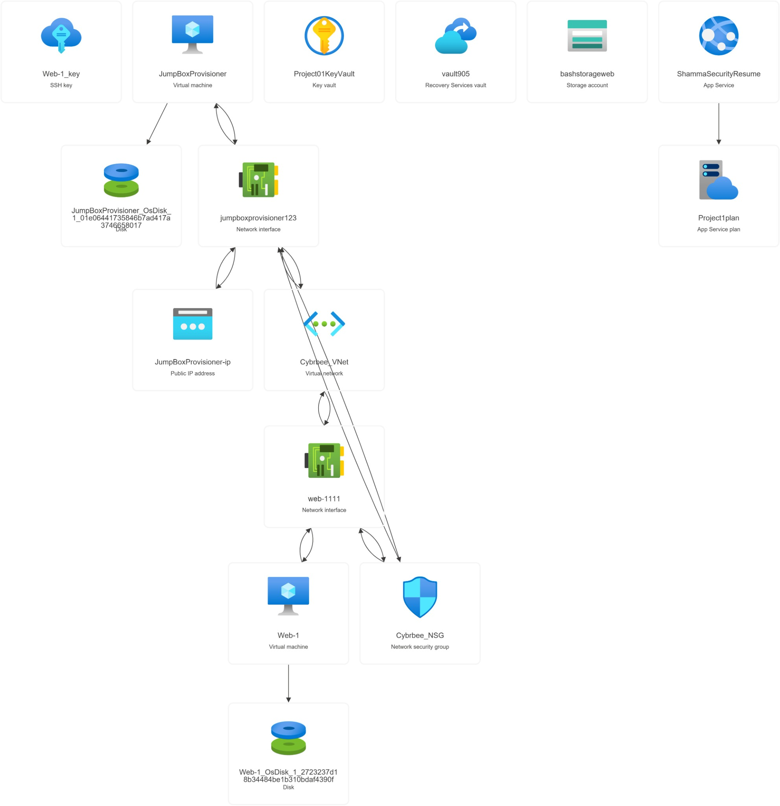

## 12. Results and learning

- Provisioned and documented a two-VM Azure lab with a publicly reachable JumpBox and a private Web-1 host.
- Configured a shared NSG with restricted external SSH and a JumpBox-to-Web-1 SSH rule.
- Used Git Bash for Windows-to-Azure SSH and a separate SSH key within an Ubuntu Docker container for server management.
- Recorded a successful Ansible ping (`pong`) to Web-1.
- Diagnosed a playbook failure at `docker.io` package installation; final application deployment remains unverified.

### Security and reproducibility notes

- Keep private SSH keys, credentials, Azure access tokens and secrets out of the repository.
- The displayed public IP and client allowlist are historical configuration values, not guaranteed current addresses.
- Docker container files and keys can be lost if the container is removed without a persistent volume or backup.
- Do not expose intentionally vulnerable training apps to the public internet.
- Deallocated VMs may still incur disk and networking resource charges.

## Repository contents

```text
azure-jumpbox-ansible/
├── README.md
├── ansible/
│   ├── ansible.cfg
│   ├── hosts
│   └── pentest.yml
├── screenshots/
│   ├── 01–11 Azure screenshots
│   └── README.md
└── .gitignore
```
